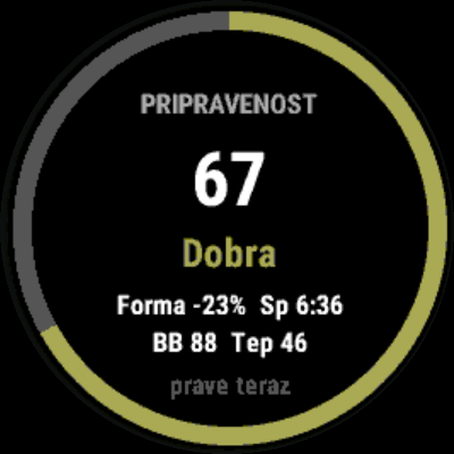
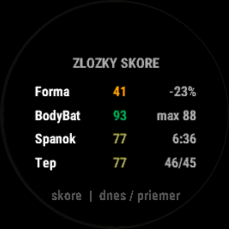
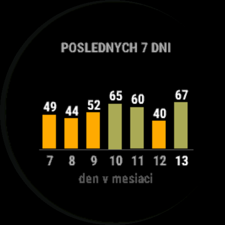

# Readiness for intervals.icu (Garmin Connect IQ widget)

*[Slovenská verzia](README.sk.md)*

A Garmin watch widget that downloads your daily wellness data from **intervals.icu** and turns it
into one morning **readiness score from 0 to 100** – similar to Garmin Training Readiness, but
based on **all** your activities, including rides recorded on a Garmin Edge with a power meter.

Built for athletes whose training is mostly not recorded on the watch (for example cyclists using an Edge):
Garmin's own readiness only sees what the watch records, while intervals.icu calculates fitness and
fatigue from every activity you upload.

| Overview | Score factors | Last 7 days |
|---|---|---|
|  |  |  |

*(Screenshots show the Slovak UI; the widget uses English on watches set to English.)*

Supported watches (round displays only): **vivoactive 4/4S/5, Venu 2/2S/2 Plus/3/3S,
Forerunner 165/255/265/955/965 (incl. S and Music), fenix 7/7S/7X, epix 2** – see `manifest.xml`.
Tested on vivoactive 4S (device and simulator) and Forerunner 255 Music (simulator).

---

## Setup

1. In **intervals.icu** go to **Settings → Developer Settings** (bottom of the page) and generate an **API key**.
2. Install the widget from the **Connect IQ Store** app on your phone.
3. In the **Garmin Connect** app open your device → **Connect IQ Apps** → this widget → **Settings**.
4. Paste the **API key**. Leave **athlete ID** as `0` (= the account the key belongs to).

The watch downloads data through your phone, so the phone must be paired and Garmin Connect running.
Your intervals.icu account must receive wellness data from Garmin (sleep, resting HR, HRV) –
check *Settings → Connections → Garmin* in intervals.icu.

### Controls
- **Tap / START** – cycles screens: **overview → score factors → last 7 days → last 30 days**.
- **Hold / menu** – forces a data refresh.
- Data refreshes automatically when the widget is opened and the data is older than 30 minutes.

---

## How the score is calculated

| Factor | Weight | Source | Scoring |
|---|---|---|---|
| **Freshness** (*Fresh*) | 35 % | intervals.icu form = fitness − fatigue, all activities | as % of fitness, following intervals.icu zones: +10 % or more = 95, 0 % = 85, −10 % = 75, −20 % = 60, −30 % = 45, −40 % = 25 |
| **HRV** | 30 % | overnight HRV from the watch | today vs. your own ~4-week baseline (z-score) |
| **Sleep** | 20 % | watch | sleep score; if missing, sleep duration (8 h = 100, 6 h = 65) |
| **Resting HR** | 15 % | watch | higher than your baseline = worse |
| **Body Battery** | 20 % | read on the watch | **only when HRV is missing** (e.g. vivoactive 4S): morning peak since midnight, 85 = 90, 70 = 70, 50 = 40 |
| **Recovery** | 15 % | Garmin recovery time from the watch | only watches that provide it to Connect IQ (Forerunner, fenix, epix, Venu 3, vivoactive 5); 0 h = 100, 12 h = 85, 24 h = 65, 36 h = 45, 48 h = 30, 72 h = 10 |

- **Freshness** is what intervals.icu calls *Form*: fitness (~6-week training load) minus fatigue (~7-day load),
  shown as % of fitness. **Positive = rested, negative = tired from recent training.** −23 % means fatigue is
  23 % above your fitness – typical for a productive training block (intervals.icu calls −10 to −30 % *optimal*),
  but it lowers today's readiness for another hard session.
- Body Battery is **never combined with HRV** – Garmin derives it partly from HRV, so using both would count recovery twice.
  The morning peak is used (not the current value), so the score does not drop during the day. Between midnight and 5:00 the last known morning peak (yesterday's) is used.
- **Recovery** is Garmin recovery time. Watches with Physio TrueUp (e.g. Venu 3, Forerunner 255) include rides
  recorded on an Edge, but not activities uploaded directly from apps (MyWhoosh, Rouvy) – those only show up in
  freshness from intervals.icu. The morning score uses recovery time without today's training: the first reading of
  the day (widget or glance) is counted down 1 h per hour, so a workout that raises it does not change the morning
  score. If neither the widget nor the glance is opened before training, the morning value already includes it.
  Not used on vivoactive 4/4S and Venu 2 (not available to Connect IQ there).
- Watch stress is intentionally not used: Garmin derives it from HRV, which is already in the score, and it fluctuates during the day.
- Missing factors are skipped and the weights are re-normalised.
- HRV and resting HR need at least **7 days** of data in the last 4 weeks. Until then the factor is skipped and the
  detail screen shows the number of days collected (e.g. `3d`).
- Bands and colours as in Garmin Training Readiness: **95+ Prime** (purple), 75–94 High (blue), 50–74 Moderate (green),
  25–49 Low (orange), below 25 Poor (red). Colours come from the 64-colour palette of MIP displays, so they look the same on every watch.
- **Current vs. morning score.** The big number is the *current* score: after a workout intervals.icu raises fatigue,
  freshness drops and so does the score. The *morning* score uses freshness from before today's training
  (yesterday's fitness and fatigue decayed by one day, as intervals.icu does); all other factors are the same.
  When the two differ by more than 2 points, the morning score is shown small and pale after the big number
  (e.g. `66 /87`), and the factors screen shows freshness as *current / morning* (e.g. `-43/-11%`), and recovery the same way (e.g. `30/4h`).
- **Glance:** on watches with a glance list (e.g. Forerunner 255, Venu 3) the widget shows the last downloaded
  score, morning score and band in the list. The glance does not download data itself – open the widget to refresh.
- **History (7 and 30 days)** shows each day's **morning** score, back-calculated from intervals.icu data, so it is
  available immediately and not affected by the time of day you trained. Past days do not use Body Battery or recovery time
  (the watch does not keep their history). The 30-day screen also shows average, minimum and maximum.
- The widget downloads 63 days of wellness data (30 days of history + 4-week baseline); HRV and resting HR are
  always compared with the previous 4 weeks.
- The app version is shown on the loading screen.

All weights and thresholds are at the top of `source/ReadinessCalc.mc`.

---

## Privacy

The API key is stored in the widget settings on your watch and is sent **only to intervals.icu** (HTTPS) to download
your wellness data. No data is sent to the developer or any third party. Body Battery is read on the watch and never
leaves the device.

Not affiliated with intervals.icu or Garmin.

---

## Building from source

1. Install **Visual Studio Code**, the **Connect IQ SDK Manager** (https://developer.garmin.com/connect-iq/sdk/)
   and the **Monkey C** extension. In the SDK Manager download the SDK and your device(s).
2. `Ctrl+Shift+P` → **Monkey C: Verify Installation**, then **Monkey C: Generate a Developer Key**.
3. Copy `properties.example.xml` to `resources/properties/properties.xml` (ignored by git).
4. Run in the simulator with `Ctrl+F5`. Enter your API key in the simulator via
   **File → Edit Persistent Storage → Edit Application.Properties data** – do not put it in the file.

### Sideloading (USB)
`Ctrl+Shift+P` → **Monkey C: Build for Device**, then copy the `.prg` file to **GARMIN/APPS** on the watch.
Settings in Garmin Connect are not available for sideloaded apps, so for a USB build the API key has to be
in `resources/properties/properties.xml` – it is then embedded in the `.prg`, so do not share that file.

### Releasing (Connect IQ Store)
The project builds two separate store apps with different IDs:

| | Public | Beta |
|---|---|---|
| File | `export/Readiness.iq` | `export/Readiness-beta.iq` |
| App ID | `2de113d6…` (`manifest.xml`) | `fd723a7f…` (generated by the script) |
| Name on the watch | Readiness | Readiness BETA |

```powershell
powershell -ExecutionPolicy Bypass -File scripts\export.ps1              # both
powershell -ExecutionPolicy Bypass -File scripts\export.ps1 -Only beta   # beta only
powershell -ExecutionPolicy Bypass -File scripts\export.ps1 -Only public # public only
```

Add `-Version 1.0.4` to set the version number shown in the app (`resources/strings/version.xml`, commit it afterwards).
It must match the version you enter when uploading to the store.

The script refuses to export if `resources/properties/properties.xml` contains a real API key
(property defaults become the default settings of the store app). All devices listed in `manifest.xml`
must be downloaded in the SDK Manager. Upload at https://apps-developer.garmin.com.
Store texts, icon and screenshots are in `store/`.

---

## Troubleshooting

| Message | Cause |
|---|---|
| *API key missing* | no key in the widget settings in Garmin Connect (USB build: in `properties.xml`) |
| *Wrong API key / ID* (401/403) | invalid key – generate a new one |
| *Wrong athlete ID* (404) | enter your ID in the form `i123456` |
| *Phone not connected* | watch not connected to the phone / Garmin Connect not running |
| *Response too large* | low memory – in `DataFetcher.mc` lower `CHUNK_DAYS` to 4 and raise `CHUNKS` to 7 |
| *Invalid response* (−400) | incomplete or unexpected data from intervals.icu – try again later |
| Sleep / RestHR `--` | last night has not synced from Garmin Connect to intervals.icu yet |

---

## Project structure
```
manifest.xml                    public app: devices, permissions, widget type
monkey.jungle / beta.jungle     build configuration (beta uses manifest-beta.xml generated by the script)
properties.example.xml          template for resources/properties/properties.xml
resources/properties/           settings (API key, athlete ID) shown in Garmin Connect
resources/strings/              English texts (default)
resources-slo/strings/          Slovak texts
resources-vivoactive4s/         30x30 launcher icon for vivoactive 4S
store/                          Connect IQ Store listing: description, icon, screenshots
scripts/export.ps1              exports public and beta .iq files, checks that no API key is included
source/ReadinessApp.mc          app entry point
source/ReadinessView.mc         drawing, cache, error messages, history chart
source/ReadinessDelegate.mc     input (buttons / touch)
source/DataFetcher.mc           downloads 63 days of intervals.icu wellness data in 7-day chunks, reads Body Battery
source/ReadinessGlance.mc       glance (row in the glance list)
source/RecoveryTime.mc          recovery time from the watch (Complications API)
source/ReadinessCalc.mc         score calculation (weights and thresholds at the top)
```
