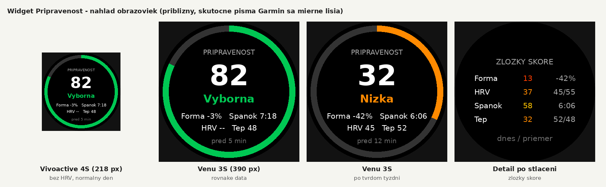

# Widget Pripravenost (Connect IQ)

*[English version](README.md)*

Widget pre Garmin hodinky, ktory si z **intervals.icu** stiahne vase denne wellness data
a vypocita jedno ranne **skore pripravenosti 0–100** – podobne ako Garmin Training Readiness,
ale zo vsetkych aktivit (Edge 540 aj hodinky).

Podporovane hodinky (iba okruhle displeje): **vivoactive 4/4S/5, Venu 2/2S/2 Plus/3/3S,
Forerunner 165/255/265/955/965 (vratane S a Music), fenix 7/7S/7X, epix 2** – zoznam je v `manifest.xml`.
Odskusane: vivoactive 4S (hodinky aj simulator), Forerunner 255 Music (simulator).

Na Forerunneri 255 sa widget ovlada tlacidlami: **START** prepina obrazovky, **podrzanie UP** (menu) obnovi data.



---

## Ako sa pocita skore

| Zlozka | Vaha | Odkial | Ako sa hodnoti |
|---|---|---|---|
| **Forma** | 35 % | intervals.icu (fitness – unava, zo vsetkych aktivit) | forma v % z fitness: +10 % a viac = 95 b., 0 % = 80 b., −20 % = 50 b., −40 % = 15 b. |
| **HRV** | 30 % | nocna HRV z hodiniek | dnesna hodnota oproti vasmu priemeru za ~4 tyzdne (z-skore) |
| **Spanok** | 20 % | hodinky | skore spanku; ak chyba, dlzka spanku (8 h = 100 b., 6 h = 65 b.) |
| **Pokojovy tep** | 15 % | hodinky | vyssi ako vas priemer = horsie |
| **Body Battery** | 20 % | priamo z hodiniek | **iba ak chyba HRV** (napr. Vivoactive 4S): ranne maximum Body Battery od polnoci, 85 = 90 b., 70 = 70 b., 50 = 40 b. |

Body Battery sa nikdy nepouzije spolu s HRV, lebo Garmin ho z HRV pocita a islo by o dvojite
zapocitanie. Pouziva sa ranne maximum (nie aktualna hodnota), aby skore cez den neklesalo.
Pred 5:00 rano sa Body Battery nepouzije. Hodinky so starsim Connect IQ ho nemusia poskytovat,
vtedy sa jednoducho vynecha.

Ak niektora zlozka chyba, vahy sa automaticky prepocitaju. **Vivoactive 4S HRV nemeria**,
takze skore sa pocita z formy, spanku a tepu. Po prechode na Venu 3S sa HRV zapocita samo,
netreba nic menit.

Pasma: **80+ Vyborna**, 60–79 Dobra, 40–59 Priemerna, 25–39 Nizka, pod 25 Velmi nizka.

Na priemer (baseline) HRV a tepu treba aspon 7 dni dat za posledne 4 tyzdne. Kym ich nie je dost, zlozka sa vynecha a v detaile sa namiesto skore ukaze pocet dni, napr. `3d`.

### Ovladanie
- **Stlacenie / klepnutie** – prepina obrazovky: **prehlad → zlozky skore → historia 7 dni**.
- **Historia** je spatne dopocitana z dat intervals.icu, takze je hned k dispozicii. Pri minulych dnoch
  sa nepouziva nahrada z vcerajska ani Body Battery (hodinky jeho historiu neuchovavaju),
  preto sa dnesny stlpec moze od vcerajsich trochu lisit sposobom vypoctu.
- **Podrzanie (menu)** – vynutene obnovenie dat.
- Data sa pri otvoreni widgetu obnovia automaticky, ak su starsie ako 30 minut.

---

## Zostavenie a instalacia (cca 20–30 min prvykrat)

### 1. Nainstalujte nastroje (zadarmo)
1. **Visual Studio Code** – https://code.visualstudio.com
2. **Connect IQ SDK Manager** – https://developer.garmin.com/connect-iq/sdk/
   - Prihlaste sa Garmin uctom, stiahnite najnovsie **SDK**.
   - V zalozke **Devices** stiahnite **vivoactive 4S** (a neskor **Venu 3S**).
3. Vo VS Code nainstalujte rozsirenie **Monkey C** (od Garminu).
4. Vo VS Code: `Ctrl+Shift+P` → **Monkey C: Verify Installation**.
5. `Ctrl+Shift+P` → **Monkey C: Generate a Developer Key** (ulozte si ho, potrebujete ho na kazde zostavenie).

### 2. Vlozte svoj API kluc
1. Na intervals.icu: **Settings → Developer Settings** (dole na stranke) → vygenerujte **API key**.
2. Skopirujte vzor `properties.example.xml` do `resources/properties/properties.xml`.
3. V `resources/properties/properties.xml` nahradte `SEM_VLOZTE_API_KLUC` svojim klucom.
4. `athleteId` nechajte `0` (= vas ucet). Ak by widget hlasil chybu ID, zadajte svoje ID
   z adresy intervals.icu v tvare `i123456`.

> `resources/properties/properties.xml` je v `.gitignore`, takze sa vas kluc nikdy nedostane do gitu.
> Kluc vsak bude sucastou skompilovaneho suboru `.prg`. Ten nikomu neposielajte.

### 3. Vyskusajte v simulatore
1. Vo VS Code otvorte priecinok `ReadinessWidget` (File → Open Folder).
2. `Ctrl+F5` (Run Without Debugging) → vyberte **vivoactive4s**.
3. Simulator sa pripoji priamo na internet, takze uvidite skutocne data z vasho uctu.

### 4. Nahrajte do hodiniek
1. `Ctrl+Shift+P` → **Monkey C: Build for Device** → vyberte **vivoactive4s** → vyberte vystupny priecinok.
2. Pripojte hodinky USB kablom.
   - **Windows**: hodinky sa zobrazia ako disk/zariadenie.
   - **Mac**: pouzite **OpenMTP** alebo Android File Transfer (hodinky pouzivaju MTP).
3. Skopirujte vzniknuty subor `.prg` do priecinka **GARMIN/APPS** v hodinkach.
4. Odpojte hodinky. Widget najdete v zozname widgetov (na Vivoactive 4S potiahnutim hore/dole).
   Ak sa nezobrazi, pridajte ho v nastaveniach hodiniek → Widgety.

Hodinky robia webove poziadavky cez telefon, takze musi byt spustena aplikacia **Garmin Connect**
a hodinky musia byt s telefonom spojene.

---

## Connect IQ obchod: verejna verzia a beta

Projekt vytvara **dve samostatne aplikacie** s roznym ID:

| | Verejna | Beta |
|---|---|---|
| Subor | `export/Readiness.iq` | `export/Readiness-beta.iq` |
| ID aplikacie | `2de113d6...` (manifest.xml) | `fd723a7f...` (vytvori skript) |
| Nazov na hodinkach | Readiness / Pripravenost | Readiness BETA / Pripravenost BETA |
| Kto ju vidi | vsetci (po schvaleni Garminom) | iba vy, bez schvalovania |
| Na co | pre ostatnych pouzivatelov | testovanie novej verzie pred zverejnenim |

V oboch sa **API kluc zadava v aplikacii Garmin Connect** (nastavenia widgetu), nie v subore.

### 1. Priprava (raz)
1. V **SDK Manageri → Devices** stiahnite vsetky hodinky z `manifest.xml` (vivoactive 4/4S/5,
   Venu 2/2S/2 Plus/3/3S, Forerunner 165/255/265/955/965 vratane verzii S a Music, fenix 7/7S/7X, epix 2).
   Ak niektore nechcete, odstrante ich cez **Monkey C: Edit Products**.
2. Developer key ma byt v `Dokumenty\garmin\developer_key` (inak ho skriptu zadajte cez `-DeveloperKey`).
3. V `resources/properties/properties.xml` musi byt `SEM_VLOZTE_API_KLUC` – skript to skontroluje
   a ak tam najde skutocny kluc, export zastavi. Hodnoty z tohto suboru sa v obchode stavaju
   predvolenymi nastaveniami pre kazdeho.
4. Na testovanie v simulatore zadajte kluc cez
   **File → Edit Persistent Storage → Edit Application.Properties data** (nie do suboru).

### 2. Export (vo VS Code terminali)
```powershell
powershell -ExecutionPolicy Bypass -File scripts\export.ps1              # obe verzie
powershell -ExecutionPolicy Bypass -File scripts\export.ps1 -Only beta   # len beta
powershell -ExecutionPolicy Bypass -File scripts\export.ps1 -Only public # len verejna
```
Subory `.iq` vzniknu v priecinku `export/` (je v `.gitignore`).

### 3. Nahratie do obchodu
1. Prihlaste sa na **https://apps-developer.garmin.com** (novy vyvojarsky portal; Garmin ucet,
   pri prvom prihlaseni prijmite podmienky pre vyvojarov). Priamy odkaz na nahratie:
   https://apps.garmin.com/en-US/developer/upload
2. **Beta:** Upload an App → `Readiness-beta.iq` → zaskrtnite **Beta App**. Dostupna hned.
3. **Verejna:** Upload an App → `Readiness.iq` → **bez** zaskrtnutia Beta. Garmin ju skontroluje
   (zvycajne niekolko dni) a potom ju najde kazdy v obchode.
4. Vo formulari pouzite podklady z priecinka `store/`: nazov, kratky a dlhy popis (EN/SK),
   text o ochrane udajov (`popis.md`), ikonu `ikona_500.png` a snimky obrazovky.
   Kategoria: **Health & Fitness**. Verziu zacnite `1.0.0`.

### 4. Instalacia a nastavenie
1. V telefone: **Connect IQ** → vyhladajte aplikaciu → nainstalujte.
   **Beta** sa po zmenach obchodu (2026) v aplikacii lahko nenajde. Podla fora funguje: v prehliadaci
   **telefonu** otvorte stary dashboard https://apps.garmin.com/developer/dashboard, kliknite na betu
   a odkaz otvorte v aplikacii Connect IQ.
2. **Garmin Connect** → zariadenie → **Aplikacie Connect IQ** → widget → **Nastavenia**.
3. Vlozte **API kluc**, **ID atleta** nechajte `0`. Widget si po ulozeni stiahne data.

Ak mate widget nahraty aj cez USB, najprv ho z hodiniek zmazte (GARMIN/APPS).

### Nova verzia
1. Upravy vyskusajte v simulatore.
2. `export.ps1 -Only beta` → nahrajte k **beta** aplikacii (Upload new version) → vyskusajte na hodinkach.
3. `export.ps1 -Only public` → nahrajte k **verejnej** aplikacii s vyssim cislom verzie (napr. 1.0.1).

---

## Jazyk
Widget pouzije jazyk hodiniek: **anglictina** (predvolena) alebo **slovencina**. Texty su v
`resources/strings/strings.xml` (EN) a `resources-slo/strings/strings.xml` (SK).

---

## Pridanie dalsich hodiniek (napr. Venu 4, Forerunner 170)
Vo VS Code: `Ctrl+Shift+P` → **Monkey C: Edit Products** → zaskrtnite hodinky.
Najprv ich stiahnite v SDK Manageri (Devices). Rozlozenie obrazovky sa prisposobi samo.

---

## Riesenie problemov

| Hlasenie | Pricina |
|---|---|
| *Chyba API kluc* | kluc nie je zadany v nastaveniach widgetu v Garmin Connect (pri instalacii cez USB v `properties.xml`) |
| *Zly API kluc / ID* (401/403) | nespravny kluc; vygenerujte novy |
| *Nespravne ID atleta* (404) | zadajte ID v tvare `i123456` |
| *Telefon nepripojeny* | hodinky nie su spojene s telefonom / nebezi Garmin Connect |
| *Odpoved prilis velka* | malo pamate; v `DataFetcher.mc` znizte `CHUNK_DAYS` na 4 a zvyste `CHUNKS` na 7 |
| *Neplatna odpoved* (−400) | starsi firmware nevie spracovat odpoved; dajte vediet, upravime format |
| Spanok / tep `--` | hodinky este nesynchronizovali poslednu noc do Garmin Connect a intervals.icu |

---

## Struktura projektu
```
manifest.xml                    hodinky, opravnenia, typ aplikacie (widget)
monkey.jungle                   konfiguracia zostavenia
properties.example.xml          vzor pre API kluc (skopirujte do resources/properties/properties.xml)
resources/properties/           API kluc a ID atleta (+ nastavenia pre Garmin Connect)
resources/strings/              anglicke texty (predvolene)
resources-slo/strings/          slovenske texty
resources-vivoactive4s/         ikona 30x30 pre Vivoactive 4S
store/                          podklady do Connect IQ obchodu (popis, ikona, snimky)
beta.jungle                     zostavenie beta verzie (manifest-beta.xml vytvori skript)
scripts/export.ps1              export verejnej a beta verzie (.iq) s kontrolou API kluca
source/ReadinessApp.mc          vstupny bod aplikacie
source/ReadinessView.mc         kreslenie obrazovky, cache, chybove hlasenia
source/ReadinessDelegate.mc     ovladanie (tlacidla / dotyk)
source/DataFetcher.mc           stahovanie dat z intervals.icu po 7-dnovych castiach
source/ReadinessCalc.mc         vypocet skore (vahy a pasma sa daju upravit hore v subore)
```
